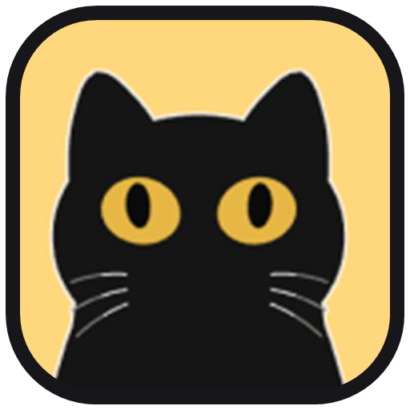

<div align="center">



# PawKey · 爪键猫

**轻量、极简、100% 本地离线的 macOS 3D 桌面打字伴侣 & 机械键盘声学工坊**

A lightweight, native macOS 3D desktop typing companion with real 104-key mechanical switch acoustics.

[](https://github.com/jackiewong2020/PawKey/releases)
[](#从源码编译)
[](#安装与使用)
[](#隐私承诺)
[](LICENSE)

</div>

---

## 预览 · Screenshots

<div align="center">
  
  <br /><br />
  
  
  
</div>

---

## 核心特性 · Features

- **超轻原生 macOS 架构**：采用纯 Swift（`AppKit` + `WKWebView` + `CGEventTap` + `IOHIDManager`）+ Three.js 渲染，无需 Electron，Universal Binary（同时支持 Apple Silicon `arm64` 与 Intel `x86_64`）全包仅 **~7.9 MB**，支持空闲自动挂起音频与低功耗降帧。
- **9 只原创 3D 小猫角色 & 6 套 65% PBT 桌面套件**：
  - 奶牛（呆毛）、橘猫（胖橘）、狸花（酷眉）、三花（蝴蝶结）、白猫（皇冠）、蓝灰（眼镜领带打工猫）、布偶（樱花）、暹罗（戏精斗鸡眼）、缅因（摇滚麦穗），支持 6 种瞳色与可开关铃铛项圈。
  - 6 套桌面机械键盘主题配色，支持左手鼠标镜像与隐藏键盘模式。
- **8 套 104 键实体真录机械轴声学工坊**：
  - 内置 `Frost Click`（青轴）、`Ruby Thock`（麻将石子）、`Chestnut Bump`（茶轴）、`Midnight Thock`（静电容）、`Alpine Pop`（晶紫）、`Onyx Glide`（黑轴）、`Glacier Glide`（红轴）、`Cream Clack`（奶油脆底）。
  - 零延迟 WebAudio 内存采样 + 按下/回弹双采样（Key-Down / Key-Up）+ 动态防爆音压缩器 + 人耳曲线音量 + 交互式试音键盘 + 20 秒无声自动挂起省电。
- **生动桌面交互与摸鱼彩蛋**：
  - **拖头/拖身挪位**：拖住猫头或身体随意摆放，松手自动贴边保护并持久化位置；滚轮悬停缩放（`0.4×`–`2.0×`）。
  - **摸头 & 撒娇**：点按猫头摸摸会眯眼笑、冒爱心并打呼噜，双击喵一声；光标追踪眼神，快速晃动鼠标触发捕猎眼与眩晕星星。
  - **打工人彩蛋**：持续高速敲击会体力流汗甚至“罢工崩溃”（摸头瞬间哄好）；太久不用键盘会自动端起陶瓷拿铁喝咖啡，或冒着鼻涕泡点头打盹，久置缩成猫饼深睡。
- **专注健康 & 系统体验**：
  - 原生 macOS 浅色/暗色自适应设置界面与毛玻璃浮层提醒（多尺寸 `0.4×`–`2.0×` 自适应）。
  - 番茄专注倒计时（25 / 45 / 60 分钟）、会议投屏一键勿扰（`⌘D`）、久坐提醒、喝水打卡、每日定时事项。
  - 支持鼠标防误触穿透（按住 `Option ⌥` 临时拖动）、OBS 绿幕模式、全屏自动隐藏、开机自启与单实例防重复启动。

---

## 安装与使用 · Installation

### 方式一：直接下载 Release（推荐）

前往 [Releases 页面](https://github.com/jackiewong2020/PawKey/releases) 下载最新 `PawKey-1.0.0-macOS-Universal.dmg`，打开后将 **PawKey** 拖入 `Applications` 文件夹即可。

> **首次打开说明（未公证自签版本）**：
> 1. 若提示“无法验证开发者”，在终端执行一次：
>    ```bash
>    xattr -cr /Applications/PawKey.app
>    ```
>    或在「系统设置 → 隐私与安全性」底部点击「仍要打开」。
> 2. 开启全局打字同步：打开 **PawKey 设置**，点击「打开输入监控」，在「系统设置 → 隐私与安全性 → 输入监控」中勾选 **PawKey**，再点击「已开启，立即重启」即可在任意应用中实时敲键互动。

### 方式二：从源码编译 · Build from Source

环境要求：macOS 13.0+、Xcode Command Line Tools（`xcode-select --install`）、Node.js（用于构建时 JS 语法校验）。

```bash
git clone https://github.com/jackiewong2020/PawKey.git
cd PawKey
bash build.sh
```

脚本会自动编译 `arm64 + x86_64` 通用二进制、校验全部 JS 语法并安装至 `/Applications/PawKey.app`（可通过 `PAWKEY_APP_DIR` 指定安装目录）。

#### 商业签名与 Apple 公证打包（可选）

```bash
export PAWKEY_SIGN_IDENTITY="Developer ID Application: Your Name (TEAMID)"
export PAWKEY_NOTARY_PROFILE="pawkey-notary"
bash scripts/package-release.sh
```

---

## 隐私承诺 · Privacy

PawKey **100% 本地离线运行**：
- 仅监听物理键位码驱动 3D 动作、音效与纯数字敲击统计（统计数据仅保存在本机 `~/Library/Application Support/PawKey/config.json`）。
- **绝不记录文本内容，绝不联网，绝不收集或上传任何数据**（所有页面均开启严格 CSP `connect-src 'none'`）。

---

## 快捷键 · Shortcuts

| 快捷键 / 手势 | 功能 |
| --- | --- |
| 拖住猫头或身体 | 移动小猫位置并自动保存 |
| 悬停 + 滚轮 | 实时缩放小猫大小（40%–200%） |
| 点按 / 双击猫头 | 摸头打呼噜 / 撒娇喵一声 |
| 右键小猫 | 打开 PawKey 设置面板 |
| 按住 `Option (⌥)` | 穿透模式下临时拖动或右键设置 |
| `⌘ 1–4` / `Esc` | 设置页快速切换标签 / 关闭窗口 |
| 菜单栏 `⌘M` / `⌘D` / `⌘F` | 静音切换 / 会议勿扰 / 25 分钟番茄专注 |

---

## 开源协议 · License

本项目采用 [MIT License](./LICENSE) 开源。

第三方 MIT 开源组件致谢详见 [THIRD_PARTY_LICENSES.txt](./THIRD_PARTY_LICENSES.txt)：
- [Three.js](https://threejs.org/) (MIT License)
- [MechVibes](https://github.com/hainguyents13/mechvibes) 机械轴采样包 (MIT License)
