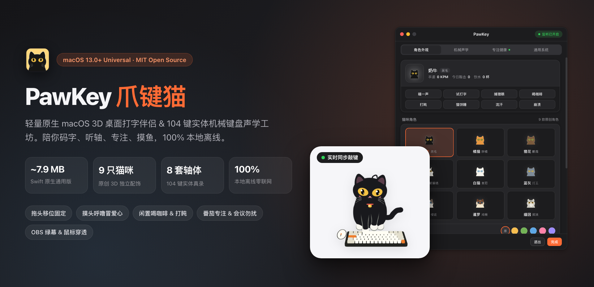
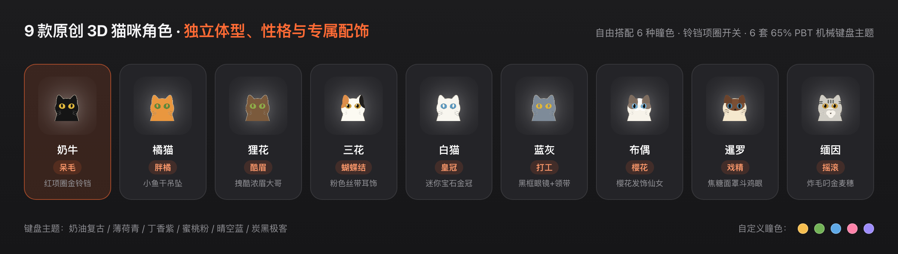
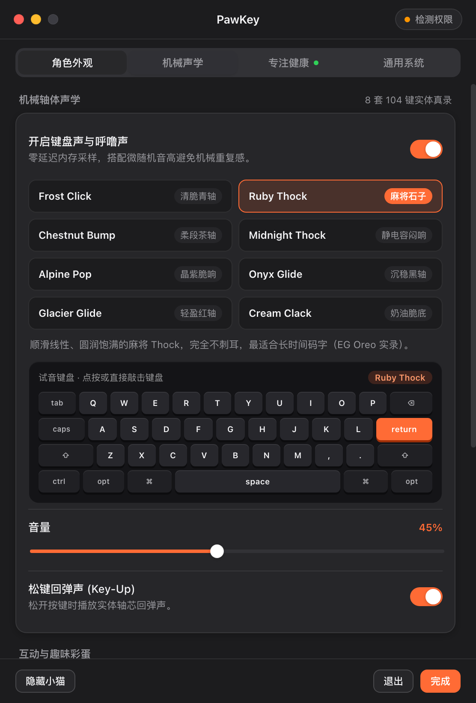
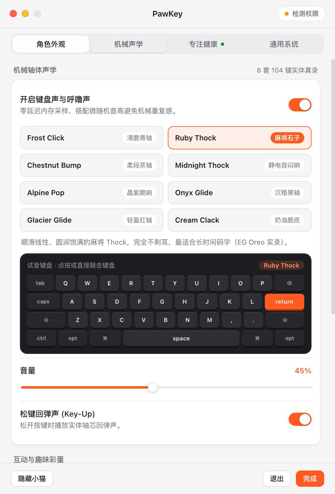
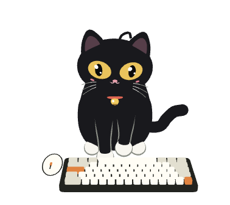
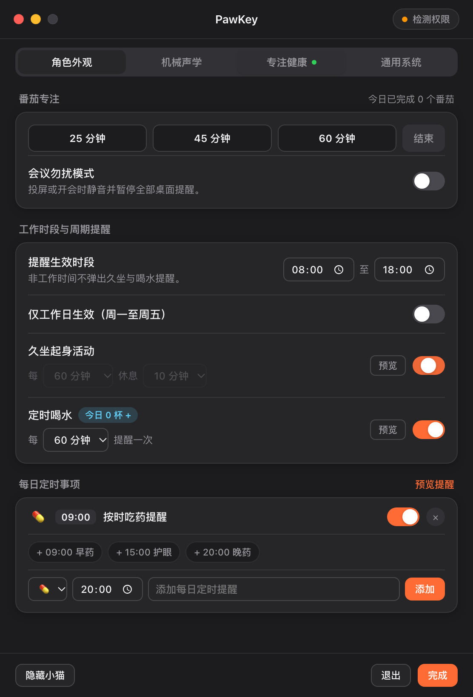
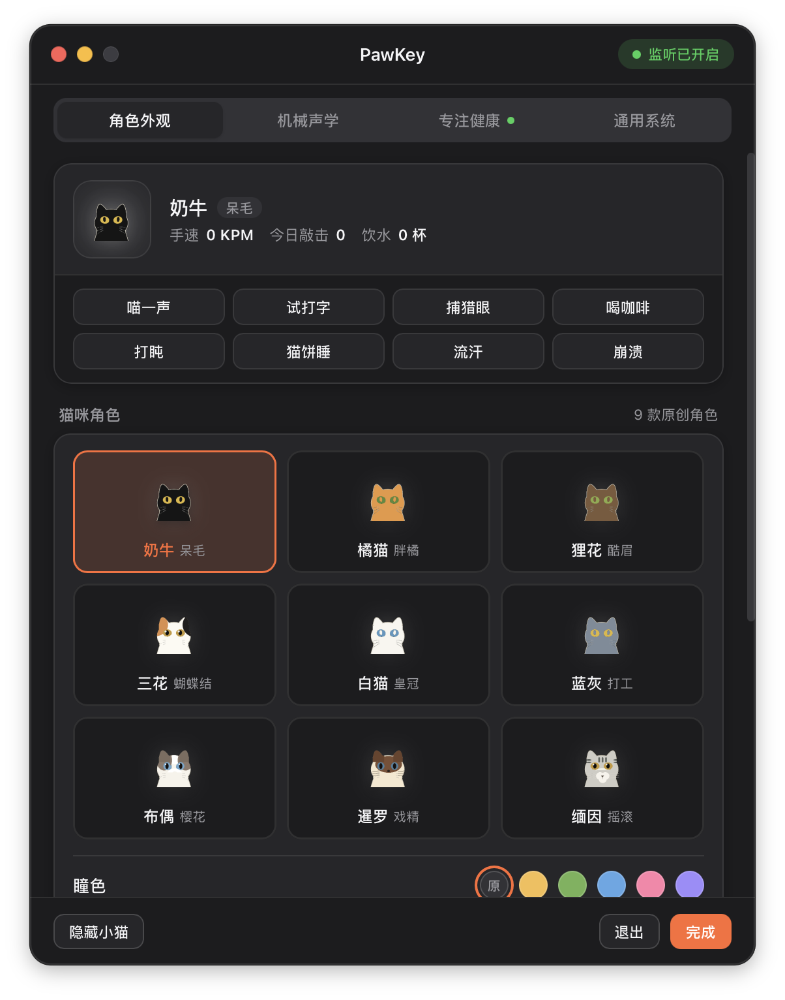
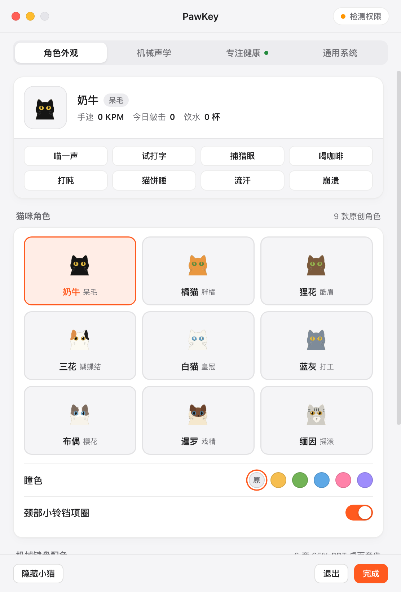
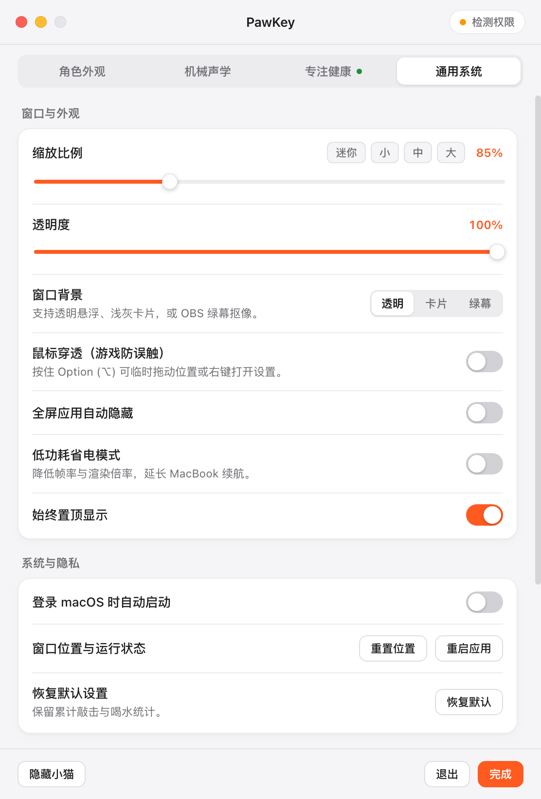

<div align="center">



<br />

# PawKey · 爪键猫

**让每一次敲键盘都变得治愈：超轻原生 macOS 3D 桌面打字小猫 & 104 键实体机械键盘声学工坊**

A lightweight, native macOS 3D desktop typing companion with real 104-key mechanical switch acoustics — zero Electron, ~7.9 MB Universal Binary, 100% offline.

[](https://github.com/jackiewong2020/PawKey/releases/latest)
[](https://github.com/jackiewong2020/PawKey/releases)
[](#为什么选择-pawkey)
[](LICENSE)

[产品简介](#产品简介--为什么选择-pawkey) · [9 只原创猫咪](#1-9-款原创-3d-猫咪与-6-套客制化键盘) · [8 套实体机械轴](#2-8-套-104-键实体真录机械键盘声学工坊) · [互动与摸鱼彩蛋](#3-生动桌面交互拖头移位与打工人彩蛋) · [专注健康提醒](#4-番茄专注会议勿扰与健康提醒) · [下载安装](#安装与使用--installation)

</div>

---

## 产品简介 · 为什么选择 PawKey？

很多 macOS 桌面宠物和按键音效软件基于 Electron 打包，动辄占用 `180–350 MB` 磁盘空间、后台常驻数百 MB 内存且耗电发热。

**PawKey（爪键猫）** 用 **纯原生 Swift（AppKit + WKWebView + CGEventTap + IOHIDManager）+ 轻量 Three.js** 从底层打造，把「3D 桌面打字猫」「实体机械键盘声学工坊」「番茄专注与健康提醒」融合进一个仅 **~7.9 MB** 的通用 macOS 应用中：

| 维度 | 常见 Electron 桌宠 / 音效工具 | **PawKey · 爪键猫** |
| --- | --- | --- |
| **安装包体积** | 120 – 300 MB | **仅 ~7.9 MB**（DMG 仅 `5.7 MB`，含双架构） |
| **芯片支持** | 常需区分 Intel / Apple Silicon | **Universal Binary** 原生同时支持 `arm64` + `x86_64` |
| **键盘音效** | 合成单调滴答声或仅支持单一音效 | **8 套 104 键实体机械轴真录**（按下/回弹双采样） |
| **续航与功耗** | 持续满帧渲染 + CoreAudio 常驻 | **低功耗降帧 + 20 秒无声自动挂起音频 + 熄屏暂停轮询** |
| **视觉风格** | 粗糙贴图或风格割裂弹窗 | **原生 macOS 浅色/暗色自适应界面 + 毛玻璃桌面浮层** |
| **隐私安全** | 部分内置统计 SDK 或需联网登录 | **100% 本地离线，严格 CSP `connect-src 'none'`，绝不记录文字** |

---

## 功能全景图解 · Feature Showcase

### 1. 9 款原创 3D 猫咪与 6 套客制化键盘



每只猫咪都拥有**独立头身比例、耳型、瞳色、项圈配色与弹簧微动配饰**，配合 6 套 65% PBT 机械键盘桌面套件与自定义瞳色，自由搭配你的专属工位伴侣：

| 角色 | 标志配饰 | 个性特征 | 默认键盘可随心换装 |
| --- | --- | --- | --- |
| **奶牛**（Cow） | 呆毛 + 红项圈金铃铛 | 敲键时呆毛随节奏晃动，经典黑白酷猫 | 奶油复古 `Cream` |
| **橘猫**（Orange） | 小鱼干吊坠 + 绿项圈 | 圆润大脸大橘，打工也要惦记干饭 | 薄荷青 `Mint` |
| **狸花**（Tabby） | 拽酷浓眉 + 深灰项圈 | 霸气中华田园酷哥，自带气场 | 丁香紫 `Lilac` |
| **三花**（Calico） | 粉色丝带蝴蝶结 | 温柔灵动大眼睛，蝴蝶结随挥爪轻颤 | 蜜桃粉 `Peach` |
| **白猫**（White） | 迷你宝石金皇冠 | 精致小公主气质，微呼吸浮动金冠 | 晴空蓝 `Sky` |
| **蓝灰**（Blue） | 黑框眼镜 + 蓝色领带 | 准时打卡的社畜打工猫，领带会随重心摆动 | 炭黑极客 `Charcoal` |
| **布偶**（Ragdoll） | 樱花发饰 + 蓬松长尾 | 仙女布偶猫，摸头开心时花饰轻晃 | 支持关闭键盘仅留小猫 |
| **暹罗**（Siamese） | 焦糖渐变面罩 | 自带轻微斗鸡眼的搞笑挖煤戏精 | 支持左手鼠标镜像布局 |
| **缅因**（Maine） | 炸毛鬓角 + 嘴叼金麦穗 | 潇洒摇滚大体型长毛猫 | 支持 6 种独立瞳色 + 项圈开关 |

---

### 2. 8 套 104 键实体真录机械键盘声学工坊

<table>
  <tr>
    <td width="50%"></td>
    <td width="50%"></td>
  </tr>
</table>

把 MacBook 蝶式/剪刀脚键盘变成发烧级客制化机械键盘！内置 **8 套 104 键实体键盘实录采样**，带交互式哑光黑试音键盘，点按或直接敲实体键盘即可实时试听对比：

| 声学套装 | 听感标签 | 实体采样原型 | 听感特色与推荐场景 |
| --- | --- | --- | --- |
| **Frost Click** | 清脆青轴 | Cherry MX Blue (PBT) | 锐利干脆的机械 Click，写代码/畅快输出首选 |
| **Ruby Thock** | 麻将石子 | EG Oreo | 圆润饱满、不刺耳的顺滑线性麻将音，**默认推荐久打不累耳** |
| **Chestnut Bump** | 柔段茶轴 | Cherry MX Brown (PBT) | 柔和段落感，敲击有分量又克制，办公全能折中之选 |
| **Midnight Thock** | 静电容闷响 | Topre (PBT) | 低沉厚实的阻尼闷响，深夜码字沉浸解压 |
| **Alpine Pop** | 晶紫脆响 | EG Crystal Purple | 轻盈通透带跳跃高音的脆响，高速输入依然清澈 |
| **Onyx Glide** | 沉稳黑轴 | Cherry MX Black (PBT) | 磨圆棱角的低沉线性鼓点，克制稳重 |
| **Glacier Glide** | 轻盈红轴 | Cherry MX Red (ABS) | 明亮干净无段落杂音，轻快顺手 |
| **Cream Clack** | 奶油脆底 | EG Oreo Classic | 饱满厚软同时触底带脆劲，层次感丰富 |

**声学引擎工程细节**：
- **按下 + 松键双采样（Key-Down / Key-Up）**：松开按键时同步还原真实轴芯回弹声（可独立开关），每次击键加入微随机音高避免“机关枪重复感”。
- **人耳感知音量曲线 & 防爆音压缩器**：内置 `DynamicsCompressorNode`，连打不破音，低音量（10%–40%）办公室微调同样细腻。
- **内存与续航双优化**：2 套轴体 LRU 缓存自动释放旧采样内存；无按键 20 秒后自动挂起 `AudioContext`，空闲时零 CoreAudio 唤醒耗电。

---

### 3. 生动桌面交互、拖头移位与打工人彩蛋

<table>
  <tr>
    <td width="38%" align="center">
      
      <br />
      <sub>实时逐键同步挥爪 · 按键高亮 · 键帽气泡（隐私模式可隐藏）</sub>
    </td>
    <td width="62%">
      <ul>
        <li><b>拖住猫头/身体自由挪位</b>：直接拖住猫头或身体移到屏幕任意角落，松手自动贴边防拖丢并持久化记住坐标；悬停滚轮可丝滑缩放 <code>40%–200%</code>。</li>
        <li><b>摸头打呼噜 &amp; 撒娇喵叫</b>：点按猫头轻抚，小猫会眯起 <code>^ ^</code> 笑眼、飘起爱心并伴随柔和呼噜声；双击猫头立即撒娇喵一声。</li>
        <li><b>全屏追眼 &amp; 摇鼠捕猎</b>：小猫眼神实时跟随全局鼠标位置；快速左右晃动鼠标会触发竖耳「盯紧猎物」捕猎眼，持续猛摇还会冒出旋转眩晕星星。</li>
        <li><b>高频打字流汗 &amp; 崩溃彩蛋</b>：持续狂敲键盘手速起飞时键盘会冒火花 🔥、小猫额头流汗 💦，体力耗尽会触发「打工人罢工崩溃」动画——<b>摸摸猫头立刻回满血哄好</b>。</li>
        <li><b>闲置摸鱼彩蛋（喝咖啡 &amp; 打盹）</b>：太久没敲键盘时，小猫会自动端起带拉花和热气的陶瓷拿铁小口抿 ☕，或者冒着 <code>zZ</code> 鼻涕泡点头打盹（一敲键瞬间惊醒开工）；长时间无操作则会缩成一团「猫饼」深睡。</li>
      </ul>
    </td>
  </tr>
</table>

---

### 4. 番茄专注、会议勿扰与健康提醒

<table>
  <tr>
    <td width="46%" align="center">
      
    </td>
    <td width="54%">
      <ul>
        <li><b>番茄专注计时器</b>：一键开启 <code>25 / 45 / 60 分钟</code> 专注（或菜单栏 <code>⌘F</code> 快捷开启），小猫头顶悬浮极简毛玻璃倒计时胶囊，达成后自动播放清脆提示音并累计今日完成数。</li>
        <li><b>会议投屏一键勿扰（<code>⌘D</code>）</b>：开会或共享屏幕时一键静音、自动收起并暂停所有桌面提醒弹窗，不尴尬不打断。</li>
        <li><b>工作时段久坐 &amp; 喝水打卡</b>：自定义生效时段与「仅工作日」规则，到期弹出原生毛玻璃提醒卡，支持「休息倒计时（小猫陪睡）」、稍后提醒与今日喝水杯数统计。</li>
        <li><b>每日定时事项</b>：内置早药、护眼、晚药快捷模板并支持自定义图标/时间/标题，到点温柔叫你。</li>
        <li><b>全尺寸响应式浮层</b>：哪怕把小猫缩到 <code>0.4×（168×150）</code> 迷你尺寸，所有气泡、提醒卡与倒计时胶囊都会自动等比紧凑排布，绝不裁切遮挡。</li>
      </ul>
    </td>
  </tr>
</table>

---

### 5. 原生 macOS 极简美学 & 极客系统能力

<table>
  <tr>
    <td width="33%"><div align="center"><sub>暗色模式 · 角色外观与实时统计</sub></div></td>
    <td width="33%"><div align="center"><sub>浅色模式 · 自动跟随系统外观</sub></div></td>
    <td width="33%"><div align="center"><sub>窗口背景、穿透、省电与快捷键</sub></div></td>
  </tr>
</table>

- **三种窗口背景模式**：`透明悬浮`（默认融入壁纸与编辑器）、`浅灰卡片`、`OBS 绿幕 (#00FF00)`（直播与录屏一键抠像）。
- **游戏防误触鼠标穿透**：开启后小猫完全不拦截点击，需要移动位置或调设置时，**按住 `Option (⌥)`** 即可临时拖动或右键打开设置。
- **全屏应用自动隐藏 & 低功耗省电模式**：看电影/全屏演示自动隐身；开启低功耗模式降低帧率与渲染倍率，延长 MacBook 续航。
- **商业级 macOS 稳健细节**：单实例防重复保护（重复打开自动唤起现有实例）、系统合盖休眠与唤醒自动恢复事件监听、防抖原子写配置不损数据、菜单栏快捷开关（静音 `⌘M` / 勿扰 `⌘D` / 专注 `⌘F`）。

---

## 技术架构与隐私承诺 · Architecture & Privacy

```text
macOS Global Input (4-Layer Truthful Hook)
  ├─ Layer 1: CGEventTap (.listenOnly)     ── 主通道：支持内置/蓝牙/外接/虚拟键盘与长按连发
  ├─ Layer 2: NSEvent Global Monitor       ── 辅助功能兜底通道
  ├─ Layer 3: IOHIDManager (.commonModes)  ── 底层 USB/HID 兜底通道
  └─ Layer 4: Local Key Monitor            ── 未授权时应用内本地即时体验
          │  (仅在内存传递物理键位码 KeyCode，不读取/不存储任何输入文字)
          ▼
Native Swift Host (PawKeyApp.swift · Universal arm64 + x86_64)
          │  WKScriptMessageHandler 零网络本地桥接
          ▼
WKWebView Renderer (CSP: connect-src 'none')
  ├─ Three.js 3D Flat-Lit Cat & 65% Keyboard Engine (cat3d.js)
  ├─ WebAudio 104-Key Acoustic Sampler + Compressor (pawkey-audio.js)
  └─ Native macOS Sequoia Light/Dark Settings UI (settings.html)
```

- **100% 本地离线**：所有 HTML 页面强制配置 `Content-Security-Policy: connect-src 'none'`，应用**不请求任何外部服务器、不集成任何统计 SDK、不记录任何打字内容**。
- **数据归属本机**：仅将外观偏好与纯数字敲击/饮水次数保存在本地 `~/Library/Application Support/PawKey/config.json`。

---

## 安装与使用 · Installation

### 方式一：直接下载安装包（推荐）

1. 前往 [Releases 页面](https://github.com/jackiewong2020/PawKey/releases/latest) 下载 **`PawKey-1.0.0-macOS-Universal.dmg`**（`5.7 MB`）。
2. 双击打开 DMG，将 **PawKey** 拖入 `Applications` 文件夹。
3. **首次打开说明（开源自签版）**：若 macOS 提示“无法验证开发者”，在终端执行一次：
   ```bash
   xattr -cr /Applications/PawKey.app
   ```
   或在「系统设置 → 隐私与安全性」底部点击「仍要打开」。
4. **开启全局打字同步**：打开 **PawKey 设置**，点击顶部引导卡片的 **「打开输入监控」** → 在「系统设置 → 隐私与安全性 → 输入监控」中勾选 **PawKey** → 返回设置点击 **「已开启，立即重启」** 即可生效。

### 方式二：从源码一键编译 · Build from Source

环境要求：macOS 13.0+、Xcode Command Line Tools（`xcode-select --install`）、Node.js（仅用于 JS 语法校验）。

```bash
git clone https://github.com/jackiewong2020/PawKey.git
cd PawKey
bash build.sh
```

脚本会自动编译 `arm64 + x86_64` 通用二进制、校验全部 JS 文件并安装到 `/Applications/PawKey.app`（支持通过 `PAWKEY_APP_DIR` 指定安装路径）。

#### 商业 Developer ID 签名与 Apple 公证打包（可选）

```bash
export PAWKEY_SIGN_IDENTITY="Developer ID Application: Your Name (TEAMID)"
export PAWKEY_NOTARY_PROFILE="pawkey-notary"
bash scripts/package-release.sh
```

---

## 快捷键与手势速查 · Shortcuts

| 手势 / 快捷键 | 说明 |
| --- | --- |
| **拖住猫头 / 身体** | 自由移动小猫位置并自动保存 |
| **悬停 + 滚轮** | 实时缩放小猫尺寸（`40% – 200%`） |
| **点按 / 双击猫头** | 摸头打呼噜冒爱心 / 撒娇喵一声 |
| **右键小猫** | 打开 PawKey 设置面板 |
| **按住 `Option (⌥)`** | 鼠标穿透模式下临时拖动或右键设置 |
| **`⌘ 1–4` / `Esc`** | 设置面板切换 4 个标签页 / 关闭设置窗 |
| **菜单栏 `⌘M` / `⌘D` / `⌘F`** | 切换静音 / 会议勿扰 / 开启 25 分钟番茄专注 |

---

## 开源协议与致谢 · License

本项目基于 [MIT License](./LICENSE) 开源，欢迎 Star、Fork 与 PR！

第三方 MIT 开源组件完整声明见 [THIRD_PARTY_LICENSES.txt](./THIRD_PARTY_LICENSES.txt)：
- [Three.js](https://threejs.org/) — MIT License
- [MechVibes](https://github.com/hainguyents13/mechvibes) — 104 键机械轴采样包，MIT License
